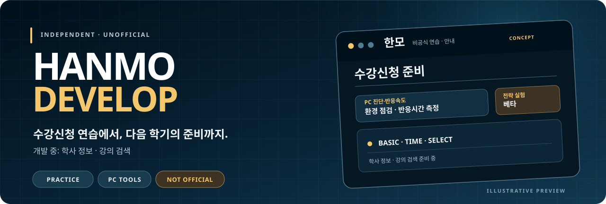
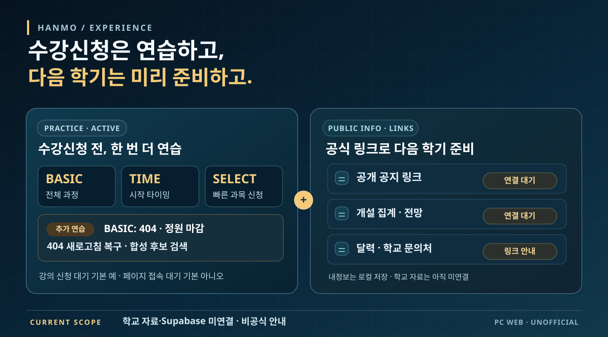
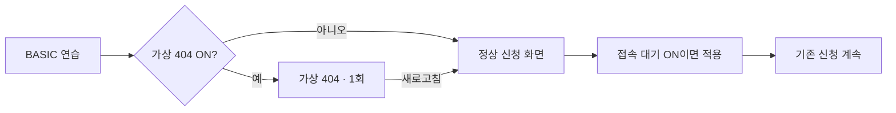

<div align="center">

  <a href="https://github.com/ot4562-glitch/Hanmo_develop"></a>

  <h1>한모 · Hanmo Develop</h1>

  <p><strong>수강신청은 미리 연습하고, 다음 학기는 더 쉽게 준비하고.</strong><br>한국외국어대학교 학생들의 모의수강신청과 학업 준비를 잇는 비공식 PC 웹 프로젝트</p>

  <p>
    <a href="https://github.com/ot4562-glitch/Hanmo_develop/actions/workflows/academic-ci.yml"></a>
    <a href="LICENSE"></a>
    
    
  </p>

  <p>
    <a href="#experience">한눈에 보기</a> ·
    <a href="#changes">추가된 기능</a> ·
    <a href="#flow">연습 흐름도</a> ·
    <a href="#next">학기 준비</a> ·
    <a href="#develop">실행 및 기술</a>
  </p>

</div>



<p align="center"><sub>한모의 방향을 표현한 일러스트입니다. 실제 브라우저 화면 캡처가 아닙니다.</sub></p>

수강신청을 앞두고 학생들이 하는 고민은 신청 버튼을 누르는 순간에만 머물지 않습니다. **어떤 강의를 담을지, 내게 해당하는 공지는 무엇인지, 다음 학기를 어떻게 채울지.** 익숙한 연습 화면에서 시작해 이런 질문들을 이어서 살펴볼 수 있다면 어떨까요?

**한모(Hanmo)**는 [dlacked/Hanmo](https://github.com/dlacked/Hanmo)의 **BASIC · TIME · SELECT 모의수강신청**을 토대로, 학사 공지·강의 검색·개설 전망·학점 정리까지 이어지는 학생용 공간을 만들어 갑니다.

**지금 바로 이용할 수 있는 것은 모의수강신청 연습**입니다. 학업 정보 화면과 관련 기능의 기반도 마련되어 있지만, 실제 학교 학사자료를 연결하기 전까지는 자료 없음과 연결 대기 상태로 안내합니다.

<a id="experience"></a>

## 수강신청은 연습하고, 다음 학기는 미리 준비하고.



<sub>왼쪽은 실제로 연습할 수 있는 모의수강신청, 오른쪽은 학업 준비를 위한 확장 화면입니다. 학사 공지·강의 데이터는 아직 연결 준비 중입니다.</sub>

### 학생이 한모에서 이어갈 경험

| 궁금한 순간 | 한모에서 이어지는 경험 |
| :--- | :--- |
| **“수강신청 화면이 아직 낯설다면?”** | BASIC·TIME·SELECT로 시작 시각과 신청 순서를 반복 연습 |
| **“내 전공 공지와 수강 일정은 어디서 확인하지?”** | 학사 공지를 찾아보고 공식 원문으로 이어지는 학생용 탐색 화면 *(자료 연동 전)* |
| **“다음 학기에 듣고 싶은 강의가 열릴까?”** | 강의 검색·개설 전망에서 학기와 과목을 살펴보는 준비 화면 *(자료 연동 전)* |
| **“이번 학기까지 학점을 얼마나 모았지?”** | 직접 입력한 학점을 정리하고 다음 학기 계획을 비교 |

수강신청 연습과 학사 안내가 따로 멈추지 않고 **학생 스스로 다음 행동을 찾는 하나의 동선**으로 이어지는 것, 그것이 한모가 만들고 싶은 경험입니다.

<a id="changes"></a>

## 원작에서 이어받은 것, 새로 더한 것

| 기존 한모의 경험 | 확장된 경험 |
| :--- | :--- |
| **BASIC · TIME · SELECT** — 전체 신청, 시작 타이밍, 과목 신청 속도 연습 | **BASIC 선택형 가상 404** — 수강신청 페이지 전환 시 1회 오류 화면을 보여주고 실제 브라우저 새로고침으로 복구 |
| **SETTING** — 연습할 과목 수와 기본 신청 대기 | **대기 조건 분리** — 강의 신청 대기 기본 **예**, 신청 페이지 접속 대기 기본 **아니오** |
| **익숙한 신청 화면과 결과 흐름** | **돌발상황 예/아니오 저장** — 새 탭 첫 방문은 OFF, 같은 탭에서 다른 페이지에 다녀와도 선택 유지 |
| **모의수강신청에 집중한 PC 웹** | **내정보·학사공지·강의 검색·개설 전망·학점 정리 화면** — 학생 직접 입력과 검수된 학사정보를 구분 |

**변경하지 않은 핵심:** 원작의 <code>practice.html</code>·<code>selectZone.html</code> 및 핵심 신청 로직은 보호합니다. BASIC/TIME/SELECT의 기존 대기번호·키보드·시간 측정·결과 동작은 유지해야 할 기준입니다. 가상 404는 별도 페이지 전환 로직에서 처리하며, **실제 학교 수강신청이나 네트워크 장애와 연결되지 않습니다.** 실제 Windows Chrome/Edge 전체 모드·키보드 QA는 별도 검증 항목입니다.

<a id="flow"></a>

### BASIC 돌발상황, 한눈에 보기

<p align="center">
  
</p>

<sub>돌발상황은 **기본 OFF**로 기존 흐름을 유지합니다. 가상 404는 BASIC에서만 제공하며 브라우저 새로고침으로 복구합니다. 접속 대기 설정이 켜져 있다면 복구 이후 적용됩니다.</sub>

<details>
<summary>분기 조건 상세 보기 · Mermaid flowchart</summary>



브라우저 뒤로가기는 404 복구 방법으로 지원하지 않습니다. 이 화면은 실제 학교 서버 오류가 아닌 연습용 가상 상황입니다.

</details>

<a id="next"></a>

## 익숙한 연습에서, 학업 준비까지

신청 당일의 타이밍 연습만큼이나 중요한 것은 **학생이 자기 상황에 맞는 학사 공지와 강의 정보를 쉽게 찾고 다음 학기를 준비하는 일**입니다. 한모는 연습을 마친 뒤에도 공지·강의·학점 계획을 같은 공간에서 살펴보는 경험을 지향합니다.

학사 정보의 실자료 연동은 아직 진행 전이므로, 화면이 갖춰져 있다는 사실을 실제 서비스 운영으로 표현하지 않습니다.

### 지금 이용할 수 있거나 미리 살펴볼 수 있는 화면

| 화면 | 해볼 수 있는 일 | 현재 상태 |
| :--- | :--- | :--- |
| **모의수강신청** · [열기](html/vsugang.html) | BASIC/TIME/SELECT, 선택형 404, 두 가지 접속 대기 설정 | **모의연습 이용 가능** · 실제 신청 아님 |
| **내정보** · [열기](html/planner.html) | 캠퍼스·전공·입학년도 직접 입력, 브라우저에 저장 | **직접 입력 기능 이용 가능** · 학교 학적과 미연동 |
| **학사 공지** · [열기](html/academic-timeline.html) | 공지를 찾아볼 학생용 화면과 안내 상태 확인 | 실제 학교 공지 자료 연결 대기 |
| **강의 검색** · [열기](html/catalog.html) | 강좌 검색·목록 화면 확인 | 실제 강의·교수 자료 연결 대기 |
| **개설 전망** · [열기](html/forecast.html) | 학수번호·학기 입력과 조회 화면 확인 | 실제 개설 이력 연결 대기 |
| **학점 정리** · [열기](html/academic-progress.html) | 자가 입력 학점 합산과 학기 계획 참고 | **계산 기능 이용 가능** · 공식 졸업 판정 아님 |

<sub>**안내:** 학사 데이터 설정은 현재 비활성 상태이며 학교 공식 서비스와 연동하지 않습니다. 학사 일정·신청 자격 등 중요한 판단은 [한국외국어대학교 공식 홈페이지](https://www.hufs.ac.kr/)와 원문 공지를 확인해 주세요. 자료 이용·검수·운영 기준은 [아키텍처](docs/architecture.md)에서 확인할 수 있습니다.</sub>

<a id="develop"></a>

## 프로젝트 살펴보기

한모는 정적 **HTML/CSS + JavaScript/JSDoc** 기반의 PC 웹입니다. 모의수강신청 로직을 유지하면서 학업 화면과 검색·계산 코어를 분리해 확장할 수 있게 구성했습니다. 학교 계정 로그인·공식 성적 원장 연동은 포함하지 않습니다.

```bash
git clone https://github.com/ot4562-glitch/Hanmo_develop.git
cd Hanmo_develop
npm install --ignore-scripts --no-audit --no-fund
npm run check
```

<sub>Node.js 22 기준. <code>npm run check</code>는 소스·타입 검사, 단위/모의신청 회귀, 정적 사이트 빌드와 스모크 검사를 실행합니다. <code>npm run check:legacy</code>는 원본 모의신청 관련 회귀 검사입니다. 학생용 빌드 결과는 <code>dist/</code>에서 로컬 HTTP 서버로 확인할 수 있습니다.</sub>

<details>
<summary><strong>주요 코드 경로와 협업 기준</strong></summary>

| 경로 | 역할 |
| :--- | :--- |
| <code>html/practice.html</code> · <code>html/selectZone.html</code> | 원작 모의신청의 보호된 동작 기준 |
| <code>js/vsugang.js</code> · <code>js/scenario-settings.js</code> · <code>js/hanmoSys.js</code> | 모드·대기 설정과 가상 404 전환 처리 |
| <code>js/academic/</code> | 학업 계산, 개설 전망, 공지·FAQ/근거 검색 코어와 테스트 |
| <code>js/academic-data-source.js</code> · <code>data/</code> | 학생용 데이터 상태 구분 및 비활성 기본 설정 |
| <code>tests/</code> · <code>scripts/</code> | 회귀 테스트·보호 기준선·정적 사이트 검증 |
| <code>docs/architecture.md</code> | 현재 유효한 설계·구현 범위·미완료 인수 조건의 정본 |

학생용 검증과 실제 운영 인수는 구별합니다. 원작 파일·공식 데이터·라이선스 경계를 바꾸는 작업은 별도 검토와 승인이 필요합니다.

</details>

**[아키텍처](docs/architecture.md)** · **[기여 및 작업 규칙](AGENTS.md)** · **[개발 이슈](https://github.com/ot4562-glitch/Hanmo_develop/issues)** · **[GPL-3.0 라이선스](LICENSE)**

---

<div align="center">
  <p><strong>수강신청을 연습하는 곳에서, 다음 학기를 준비하는 곳으로.</strong></p>
  <sub>Based on <a href="https://github.com/dlacked/Hanmo">dlacked/Hanmo</a> · 비공식 한국외국어대학교 학생 프로젝트<br>학교 공식 서비스가 아니며 실제 수강신청·학교 로그인·공식 졸업사정을 제공하지 않습니다.</sub>
</div>
