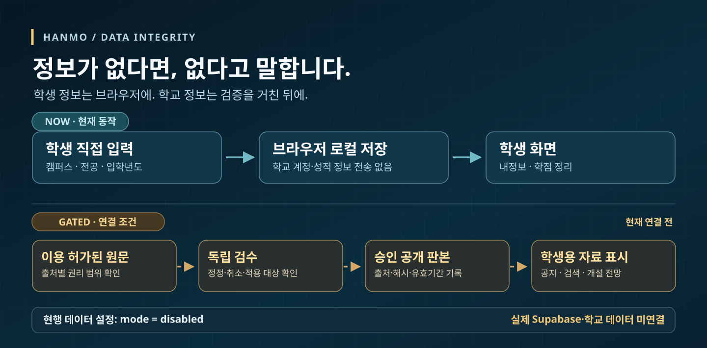

  

  <h1>한모 · Hanmo Develop</h1>

  
<strong>수강신청 연습에서, 다음 학기의 준비까지.</strong> 원작의 모의수강신청 경험을 바탕으로 학사정보를 더 명확하게 살펴보는 비공식 학생 프로젝트

  

    
    
    
    
  

  

    <a href="#experience">한눈에 보기</a> ·
    <a href="#changes">추가된 기능</a> ·
    <a href="#flow">연습 흐름도</a> ·
    <a href="#data">학업정보와 신뢰</a> ·
    <a href="#develop">실행 및 기술</a>
  

한모의 방향을 표현한 일러스트입니다. 실제 브라우저 화면 캡처가 아닙니다.

수강신청을 연습하는 순간은 짧지만, **어떤 강의를 듣고 어떤 공지를 확인할지 결정하는 과정**은 그보다 훨씬 깁니다.

**한모(Hanmo)**는 [dlacked/Hanmo](https://github.com/dlacked/Hanmo)의 **BASIC · TIME · SELECT 모의수강신청**을 유지하면서, 그 전후에 필요한 학업 정보까지 하나의 PC 웹 경험으로 확장합니다. 지금 동작하는 연습 기능과 아직 실제 자료가 필요한 학업 기능은 분명히 구별합니다.

## 연습의 몰입감은 그대로. 확인의 기준은 더 분명하게.

**현재 구현 기준.** 왼쪽은 실제 모의연습 동작, 오른쪽은 학생용 학업 화면입니다. 오른쪽 화면의 학교 학사자료는 **아직 연결되지 않았습니다.**

## 원작에서 이어받은 것, 새로 더한 것

| 기존 한모의 경험 | 확장된 경험 |
| :--- | :--- |
| **BASIC · TIME · SELECT** — 전체 신청, 시작 타이밍, 과목 신청 속도 연습 | **BASIC 선택형 가상 404** — 수강신청 페이지 전환 시 1회 오류 화면을 보여주고 실제 브라우저 새로고침으로 복구 |
| **SETTING** — 연습할 과목 수와 기본 신청 대기 | **대기 조건 분리** — 강의 신청 대기 기본 **예**, 신청 페이지 접속 대기 기본 **아니오** |
| **익숙한 신청 화면과 결과 흐름** | **돌발상황 예/아니오 저장** — 새 탭 첫 방문은 OFF, 같은 탭에서 다른 페이지에 다녀와도 선택 유지 |
| **모의수강신청에 집중한 PC 웹** | **내정보·학사공지·강의 검색·개설 전망·학점 정리 화면** — 학생 직접 입력과 검수된 학사정보를 구분 |

**변경하지 않은 핵심:** 원작의 <code>practice.html</code>·<code>selectZone.html</code> 및 핵심 신청 로직은 보호합니다. BASIC/TIME/SELECT의 기존 대기번호·키보드·시간 측정·결과 동작은 유지해야 할 기준입니다. 가상 404는 별도 페이지 전환 로직에서 처리하며, **실제 학교 수강신청이나 네트워크 장애와 연결되지 않습니다.** 실제 Windows Chrome/Edge 전체 모드·키보드 QA는 별도 검증 항목입니다.

## BASIC 모드 · 돌발상황 흐름도

설정을 켜지 않으면 기존 연습으로 진행합니다. **가상 404와 페이지 접속 대기가 둘 다 켜진 경우**, 404가 먼저 표시되고 **새로고침으로 복구한 뒤** 대기시간이 적용됩니다.

~~~mermaid
flowchart TB
    A["BASIC 모드 · 기존 연습 시작"] --> B{"가상 404를 선택했나요?"}
    B -- "아니오" --> D["정상 신청 페이지"]
    B -- "예" --> C["가상 404 화면 · 1회"]
    C -- "브라우저 새로고침" --> D
    D --> E{"페이지 접속 대기 ON?"}
    E -- "아니오" --> G["바로 신청 진행"]
    E -- "예" --> F["접속 대기 후 신청 진행"]
    F --> H["기존 신청·결과"]
    G --> H

    classDef original fill:#113448,stroke:#5289A3,color:#F5F9FC
    classDef choice fill:#283540,stroke:#D5AE70,color:#FFFFFF
    classDef incident fill:#493A28,stroke:#E7BE79,color:#FFF3D3
    class A,D,F,G,H original
    class B,E choice
    class C incident
~~~

이 흐름은 **BASIC의 예시**입니다. 가상 404는 TIME/SELECT에 주입되지 않으며, 브라우저 **뒤로가기는 복구 방법으로 지원하지 않습니다.** 404 화면은 실제 HTTP 404 응답이 아닌 모의 훈련용 정적 페이지입니다.

## 학업정보는 '많이'보다 '확인 가능하게'

공지의 제목만 아는 것과, **그 공지가 내 전공·학번에 적용되는지 확인하는 것**은 다릅니다. 다음 학기 강의도 과거에 보이지 않았다는 이유만으로 개설되지 않았다고 단정할 수 없습니다.

한모의 학업 기능은 이런 차이를 놓치지 않도록 **출처·적용 조건·관측 시점·정정·취소·자료 부족 상태**를 구분하도록 설계합니다. 근거를 확인할 수 없다면 빈 결과나 **'확인 필요'**를 표시합니다.

**실선:** 현재 학생 직접 입력 → 브라우저 로컬 저장. **점선:** 학사자료의 이용 허가와 독립 검수가 충족된 뒤에만 연결할 목표 흐름. 실제 학교 데이터·Supabase는 **미연결**입니다.

### 지금 제공하는 화면

| 화면 | 현재 가능한 일 | 신뢰 경계 |
| :--- | :--- | :--- |
| **모의수강신청** · [열기](html/vsugang.html) | BASIC/TIME/SELECT, 선택형 404, 두 가지 접속 대기 설정 | 실제 수강신청·신청 결과와 무관 |
| **내정보** · [열기](html/planner.html) | 캠퍼스·전공·입학년도 직접 입력, 브라우저에 저장 | 학교 로그인·공식 학적 확인 아님 |
| **학사 공지** · [열기](html/academic-timeline.html) | 자료 연결·빈 목록·오류 상태 안내 | 검수된 실제 공지 원문 미연결 |
| **강의 검색** · [열기](html/catalog.html) | 승인 자료의 검색·표시를 위한 학생용 화면 | 실제 강의·교수 공개 데이터 미연결 |
| **개설 전망** · [열기](html/forecast.html) | 학수번호·학기 입력과 근거 부족 상태 표시 | 실제 개설 이력 검수·연동 전 |
| **학점 정리** · [열기](html/academic-progress.html) | 자가 입력 학점 합산과 계획 참고 | 공식 이수·졸업사정 아님 |

**자료 연결 원칙:** <code>data/academic-source-config.json</code>의 기본값은 <code>mode: disabled</code>입니다. 학교 자료의 링크·인용·구조화·재배포 허용 범위와 독립 검수를 확인하기 전까지 공식 데이터를 수집·공개하지 않습니다. 안내하는 정보는 한국외국어대학교 공식 원문에서 다시 확인해야 합니다.

## 프로젝트 살펴보기

한모는 정적 **HTML/CSS + JavaScript/JSDoc** 중심으로 구성됩니다. 학교 계정 로그인이나 성적 원장의 서버 전송을 전제로 하지 않으며, 학업 계산·공지 후보 추출·근거 검색 코어의 자동 검증과 **실제 학교 자료를 이용한 검증**을 별개로 취급합니다.

~~~bash
git clone https://github.com/ot4562-glitch/Hanmo_develop.git
cd Hanmo_develop
npm install --ignore-scripts --no-audit --no-fund
npm run check
~~~

Node.js 22 기준. <code>npm run check</code>는 소스·타입 검사, 단위/모의신청 회귀, 정적 사이트 빌드와 스모크 검사를 실행합니다. <code>npm run check:legacy</code>는 원본 모의신청 관련 회귀 검사입니다. 학생용 빌드 결과는 <code>dist/</code>에서 로컬 HTTP 서버로 확인할 수 있습니다.

<strong>주요 코드 경로와 협업 기준</strong>

| 경로 | 역할 |
| :--- | :--- |
| <code>html/practice.html</code> · <code>html/selectZone.html</code> | 원작 모의신청의 보호된 동작 기준 |
| <code>js/vsugang.js</code> · <code>js/scenario-settings.js</code> · <code>js/hanmoSys.js</code> | 모드·대기 설정과 가상 404 전환 처리 |
| <code>js/academic/</code> | 학업 계산, 개설 전망, 공지·FAQ/근거 검색 코어와 테스트 |
| <code>js/academic-data-source.js</code> · <code>data/</code> | 학생용 데이터 상태 구분 및 비활성 기본 설정 |
| <code>tests/</code> · <code>scripts/</code> | 회귀 테스트·보호 기준선·정적 사이트 검증 |
| <code>docs/architecture.md</code> | 현재 유효한 설계·구현 범위·미완료 인수 조건의 정본 |

학생용 검증과 실제 운영 인수는 구별합니다. 원작 파일·공식 데이터·라이선스 경계를 바꾸는 작업은 별도 검토와 승인이 필요합니다.

**[아키텍처](docs/architecture.md)** · **[기여 및 작업 규칙](AGENTS.md)** · **[개발 이슈](https://github.com/ot4562-glitch/Hanmo_develop/issues)** · **[GPL-3.0 라이선스](LICENSE)**

---

  
<strong>연습은 한모에서. 학사 결정은 확인된 원문과 함께.</strong>

  Based on <a href="https://github.com/dlacked/Hanmo">dlacked/Hanmo</a> · 비공식 한국외국어대학교 학생 프로젝트 학교 공식 서비스가 아니며 실제 수강신청·학교 로그인·공식 졸업사정을 제공하지 않습니다.

