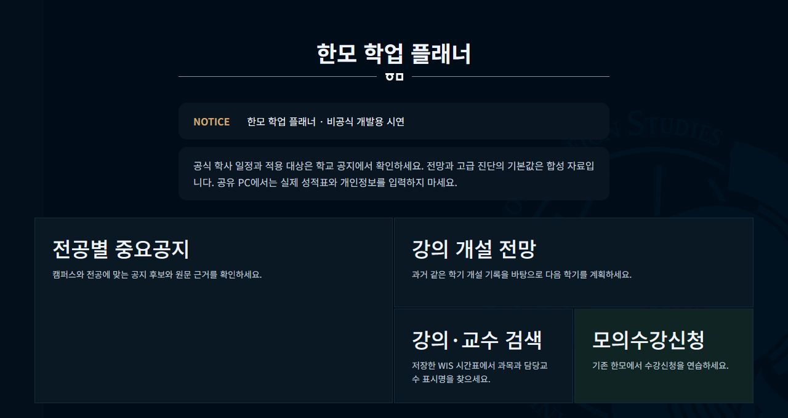

  

<h1 align="center">Hanmo Develop</h1>

<strong>내 전공 공지를 찾고, 다음 학기 수강신청을 미리 준비하는 곳</strong>

  
  

  <a href="#미리보기">미리보기</a> ·
  <a href="#핵심-기능">핵심 기능</a> ·
  <a href="#빠른-시작">빠른 시작</a> ·
  <a href="#개발-로드맵">개발 로드맵</a> ·
  <a href="docs/architecture.md">설계 문서</a>

---

**한모**는 한국외국어대학교 학생을 위한 비공식 모의수강신청 서비스입니다. 이 포크는 기존 BASIC / TIME / SELECT 연습에 더해, 학교 계정이나 성적표 없이 전공 공지와 강의 개설 이력을 찾아볼 수 있는 학업 플래너를 개발합니다.

**지원 환경: PC 전용.** 기존 모의수강신청과 새 학업 플래너 모두 PC 웹에서 사용하며, Windows PC의 Chrome·Edge를 우선 검증합니다. 스마트폰·태블릿은 공식 지원 대상이 아닙니다.

## 미리보기

위 화면은 **PR #5의 학업 플래너 개발판**입니다. 공지에는 원문·적용 근거를 연결하고, 개설 전망에는 과거 관측과 확인 필요 상태를 표시합니다. 공식 자료 사용권·검수와 운영 배포는 별도 절차를 거칩니다. [개발 PR #5](https://github.com/ot4562-glitch/Hanmo_develop/pull/5)

## 핵심 기능

| 기능 | 학생이 할 수 있는 일 | 개발 상태 |
| --- | --- | --- |
| 모의수강신청 | BASIC / TIME / SELECT로 수강신청을 연습 | 기존 한모에서 제공 |
| 전공별 공지 · 강의 개설 전망 | 내 전공의 공지 근거와 과거 학기 개설 기록을 확인 | PR #5 개발 시연. 권리와 검수가 확인된 실제 자료 연결 예정 |
| 한국어 학사 FAQ · 행사 시기 안내 | 질문에 해당하는 학교 원문을 찾고 반복 학사행사의 준비 시기를 살펴봄 | 근거·보류 기준과 평가 이슈 확정. 학생용 공개는 평가 이후 |
| 위기 대응 연습 | 정원 마감 때 대체 강좌를 고르고, 가상 접속 단절 뒤 신청 결과를 확인 | 포크에서 설정에서 ON/OFF로 개별 선택(기본 OFF) |

첫 적용 대상은 **서울·글로벌캠퍼스의 2010학년도 입학생부터 모든 전공**입니다. 개인 졸업 진단은 입학년도·전공별 학칙과 이수 기록 입력을 검증한 범위부터 확장합니다. [현행 설계](docs/architecture.md)

## 개발 로드맵

| 단계 | 개발 범위 |
| --- | --- |
| **1 · 학업 플래너** | TypeScript와 정적 HTML/CSS로 전공 공지, 개설 전망, 근거 FAQ를 개발합니다. |
| **2 · 위기 대응 연습** | 승인받은 포크에서 기존 HTML·JavaScript에 선택형 시나리오를 추가합니다. |
| **3 · Supabase 연동** | **Free($0)만 사용**하며 임창용 님이 프로젝트를 운영 관리합니다. 장애 발생 시 개발팀이 공동으로 진단·복구하고, 무료 한도 초과가 우려되면 유료 전환 대신 최적화·정적 스냅샷 대체를 적용합니다. |
| **4 · JavaScript 이관** | 실연동과 안정화 이후 계산 결과를 비교하며 TypeScript 소스를 JavaScript/JSDoc으로 옮깁니다. |

## 코드 구조

- `html/` — 모든 학생용 화면과 원본 BASIC/TIME/SELECT 페이지
- `css/` — 원래 한모 디자인을 바탕으로 한 공통 스타일 및 화면별 CSS
- `js/` — 기존 모의신청 JavaScript와 `js/academic/` TypeScript 학업 계산 코어
- `data/` — 공개 검토 가능한 학사 공지 제목 스냅샷
- `scripts/`, `tests/` — 루트에서 실행하는 빌드·검증 및 회귀 테스트
- `docs/` — 현행 아키텍처, 학업 코어 가이드, 이식 출처

모든 빌드는 루트에서 `npm install --ignore-scripts --no-audit --no-fund && npm run check`를 실행하며 공개 결과물은 `dist/`에 생성됩니다. 옛 `degree-rescue/` 하위 프로젝트는 없습니다.

## 문서와 기여

- 제품 범위와 구현 기준은 [아키텍처](docs/architecture.md)에서 확인합니다.
- 작업을 제안하거나 버그를 알릴 때는 [열린 이슈](https://github.com/ot4562-glitch/Hanmo_develop/issues)를 확인하고 [이슈 작성 규칙](agent.md#github-이슈-작성과-분류)을 따릅니다.
- 원본 프로젝트는 [dlacked/Hanmo](https://github.com/dlacked/Hanmo)이며, 이 저장소의 라이선스는 [GPL-3.0](LICENSE)입니다.
