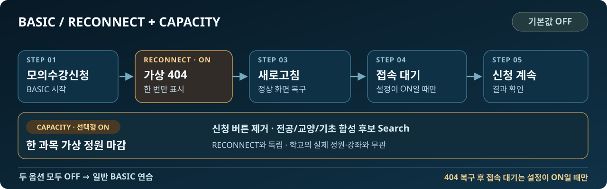

  

  # 한모 · Hanmo Develop

  **비공식 모의수강신청 연습 · 공개 학사정보 링크 탐색**

  [실행](https://ot4562-glitch.github.io/Hanmo_develop/) · [아키텍처](docs/architecture.md) · [학교 이용 조건 전문](docs/sources/2026-11-23-hufs-information-office-reply.txt)

> **본 서비스는 한국외국어대학교의 공식 서비스가 아니며, 정확한 정보는 학교 원문을 확인하시기 바랍니다.**
>
> 한모는 학교가 운영·인증·제휴·보증하는 서비스가 아닙니다. 학교 로고와 공식 시스템을 대신하는 기능을 사용하지 않으며, 수강신청·졸업·신청기한 등 중요한 판단은 학교 공식 공지와 학사시스템을 기준으로 합니다.

## 지금 제공하거나 준비하는 화면

| 영역 | 상태 | 안내 |
|---|---|---|
| [모의수강신청](html/vsugang.html) | 합성 연습 | BASIC·TIME·SELECT, 선택형 가상 404/정원 마감(각 기본 OFF), 대기 설정. 실제 신청·학교 계정과 무관 |
| [내정보](html/planner.html) | 로컬 입력 | 캠퍼스·전공·입학년도 선택값을 브라우저에만 저장. 학교 학적 인증 아님 |
| [학사 공지](html/academic-timeline.html) | 공개 데이터 미연결 | 허용된 공개 정보·공식 원문 링크 안내만 준비. 공지 본문·첨부 재게시 금지 |
| [강의 개설 전망](html/catalog.html) | 공개 데이터 미연결 | 허용된 최소 집계만 **한모 자체 비공식 전망**으로 제공할 계획. 학교 API/과거 목록 별도 제공 없음 |
| [학사 달력](html/academic-calendar.html) | 달력 화면 | 학교 확정일·신청 마감은 학교 공식 원문에서 확인 |
| [학교 문의처](html/academic-support.html) | 공개 문의 경로 | 학사 제도·절차 질문은 학교 담당 부서로 안내 |

**학교 학칙·졸업요건 페이지, 규정 기반 졸업학점 계산·졸업 가능 판정, 학교를 대신하는 학사 FAQ 페이지는 제공하지 않습니다.** 교수명·수강 관련 정보는 취급하지 않으며, 학교 계정이나 개인 성적표를 수집하지 않습니다.

### BASIC 합성 돌발상황

RECONNECT는 가상 404 표시 뒤 브라우저 새로고침으로 복구합니다. CAPACITY는 가상 정원 마감과 합성 후보 검색을 연습합니다. 둘 다 기본 OFF이며 실제 학교의 장애·개설·정원·수강 결과가 아닙니다.

## 학교 공개자료 이용 경계

한국외대 정보처의 **2026-11-23 서면 회신**을 적용합니다. 공개자료는 명시된 범위에서만 안내·수집할 수 있으며 학교는 개별 파일·과거 학기 목록·공식 API를 제공하지 않습니다. 공개 공지 본문·첨부파일을 그대로 옮기지 않고, 학칙·졸업요건 링크·인용·요약·자동 확인도 하지 않습니다.

자동 수집은 **현재 OFF**입니다. 이후에도 로그인 없는 공개 페이지, 공지 1회/일(첫 목록+신규 상세), 강의시간표 2회/학기, 10초 간격·동시 1개·실행당 50건, 수강신청/정정 기간 및 각 전후 1일 중단, 오류 시 당일 중단·무재시도 조건을 코드와 운영에서 검증하기 전에는 실행하지 않습니다. 자세한 제한과 데이터 구조는 [아키텍처 §0](docs/architecture.md)를 참조하세요.

## 개발과 검증

Node.js 22 환경에서 `npm ci` → `npm run check` → `npx playwright install chromium` → `npm run test:e2e`로 검사합니다. GitHub Actions 통과는 실제 Windows Chrome/Edge·접근성·운영 배포 승인을 대신하지 않습니다. 한모는 오픈소스 [dlacked/Hanmo](https://github.com/dlacked/Hanmo)를 기반으로 하며 저장소 라이선스는 [GPL-3.0](LICENSE)입니다.

