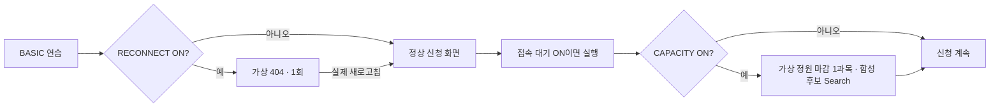
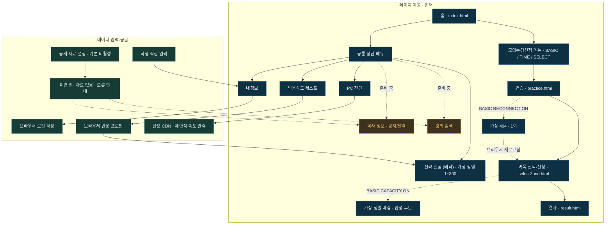

  

  <h1>한모 · Hanmo Develop</h1>

  
<strong>수강신청은 미리 연습하고, 다음 학기는 더 쉽게 준비하고.</strong> 한모 개발 저장소 · 남은 개발 범위: 학사 정보 및 강의 검색

  

    
    
    
    
  

  

    <a href="https://tofuhanmo.com/"><strong>운영 한모</strong></a> ·
    <a href="https://ot4562-glitch.github.io/Hanmo_develop/"><strong>개발판</strong></a> ·
    <a href="#experience">한눈에 보기</a> ·
    <a href="#changes">주요 기능</a> ·
    <a href="#flow">연습 흐름도</a> ·
    <a href="#next">학기 준비</a> ·
    <a href="#site-flow">전체 구조</a>
  

한모의 방향을 표현한 콘셉트 일러스트입니다. 실제 학교 시스템이나 브라우저 화면 캡처가 아닙니다.

> **본 서비스는 한국외국어대학교의 공식 서비스가 아니며, 정확한 정보는 학교 원문을 확인해 주세요.**
>
> 학교가 운영·인증·제휴·보증하는 서비스가 아닙니다. 실제 수강신청·졸업·신청 기한은 학교의 공식 공지와 학사시스템을 기준으로 확인해야 합니다.

수강신청 시작 시각에 맞춰 접속하고, 원하는 과목을 빠르게 신청하고, 예상치 못한 상황에도 대처할 수 있도록 미리 연습해 보세요. 한모는 수강신청 준비부터 모의 연습, 결과 확인까지 한 곳에서 이용할 수 있는 비공식 서비스입니다.

**Hanmo Develop**은 [한모 운영 저장소](https://github.com/chny0n/Hanmo)와 구분된 개발판입니다. BASIC · TIME · SELECT, 돌발상황, PC 진단, 반응속도 테스트, 전략 실험 (베타), 내정보는 운영 한모에 반영되었습니다. 앞으로의 신규 구현은 **학사 정보와 강의 검색 두 페이지**로 한정합니다.

## 수강신청은 연습하고, 다음 학기는 미리 준비하고.

### 학생이 한모에서 이어갈 경험

| 궁금한 순간 | 한모에서 이어지는 경험 |
| :--- | :--- |
| **“수강신청 화면이 아직 낯설다면?”** | BASIC·TIME·SELECT로 시작 시각과 신청 순서를 반복 연습 |
| **“접속 오류나 정원 마감이 발생한다면?”** | BASIC 돌발상황으로 새로고침 복구와 대체 과목 신청 연습 |
| **“내 PC와 반응속도는 어느 정도일까?”** | PC 진단으로 환경을 점검하고 반응속도 테스트로 자신의 반응 시간 측정 |
| **“어떤 순서로 신청하면 좋을까?”** | 전략 실험 (베타)에서 가상 정원·경쟁자·반응시간에 따른 추천 순서 비교 |
| **“학교 공지와 개설 강좌도 확인하고 싶다면?”** | 학사 정보·강의 검색은 준비 중. 정확한 정보는 학교 공식 원문 확인 |

## 한모의 주요 기능

| 기능 | 이용 방법 |
| :--- | :--- |
| **BASIC MODE** — 전체 과정 연습 | 시작 시각에 맞춰 신청 화면에 접속하고 목표 과목을 신청합니다. 선택형 돌발상황도 함께 연습할 수 있습니다. |
| **TIME MODE** — 시작 타이밍 연습 | 신청 시작 시각에 맞춰 수강신청 버튼을 누르는 데 걸린 시간을 측정합니다. |
| **SELECT MODE** — 과목 신청 연습 | 이미 신청 시간이 시작된 상태에서 원하는 과목을 빠르게 신청합니다. |
| **SETTING** — 과목 수와 대기 조건 | 관심강좌 1~15개와 신청할 과목 수를 설정합니다. 강의 신청 대기는 기본 **예**, 페이지 접속 대기는 기본 **아니오**이며 각각 선택할 수 있습니다. |
| **돌발상황** — 가상 접속 오류·정원 마감 | BASIC에서 RECONNECT와 CAPACITY를 독립적으로 선택합니다. 두 옵션 모두 기본 OFF입니다. |
| **PC 진단 · 반응속도 테스트 · 전략 실험 (베타) · 내정보** | 신청 전 환경을 점검하고 반응속도를 측정하며 가상 신청 순서를 비교할 수 있습니다. 내정보는 이 브라우저에서 관리합니다. |

모든 모의연습의 과목·정원·대기열은 가상입니다. 실제 학교 수강신청이나 학교 계정과 연결되지 않습니다. **매일 09:58~10:10에는 모의연습 이용이 제한됩니다.** 09:53부터 하단에 이용 제한 안내를 표시합니다.

### BASIC 돌발상황, 한눈에 보기

  

RECONNECT와 CAPACITY는 **서로 독립적이며 기본 OFF**입니다. 404는 **실제 브라우저 새로고침**으로 복구하고, CAPACITY는 합성 과목만 사용합니다.

분기 조건 상세 보기 · Mermaid flowchart

뒤로가기는 404 복구 방법으로 지원하지 않습니다. 실제 학교 접속 장애나 정원 마감을 재현하거나 판정하는 기능은 아닙니다.

## 개발 목표 · 학사 정보와 강의 검색

한모에서 수강신청을 연습하고 자신의 PC 환경과 신청 전략을 점검해 보세요. 학사 정보와 강의 검색은 자료 연결을 준비 중이며, 실제 학교 공지·학사일정·개설 강좌는 학교의 공식 원문을 확인해 주세요.

**학사 정보와 강의 검색 메뉴는 현재 비활성 상태입니다.** 공지 제목·분류 검색, 검수된 일정 표시, 강의명·학수번호 검색 및 개설 관측 집계의 기반을 준비합니다. 실제 자료 연결, 자동 수집, 공개판 검수 및 철회 처리는 별도 구현 대상입니다. [개발 범위와 남은 작업](docs/academic-development.md)

### 운영 한모 기능 및 개발판 상태

| 화면 | 해볼 수 있는 일 | 현재 상태 |
| :--- | :--- | :--- |
| **모의수강신청** · [이용하기](https://tofuhanmo.com/html/vsugang.html) | BASIC/TIME/SELECT, 기본 OFF인 가상 404·정원 마감, 독립 대기 설정, 관심강좌·전공·교양·기초 조회 연습 | **이용 가능** · 실제 신청 아님 |
| **내정보** · [이용하기](https://tofuhanmo.com/html/planner.html) | 캠퍼스·주전공·이중전공/부전공·입학년도 입력 및 저장·삭제 | **이용 가능** · 학교 학적 미연동 |
| **PC 진단** · [이용하기](https://tofuhanmo.com/html/readiness.html) | 프레임·타이머 지연·한모 연결 상태 등 10개 항목별 참고 등급 및 B 이하 개선 안내 | **이용 가능** · 학교 서버 성능 측정 아님 |
| **반응속도 테스트** · [이용하기](https://tofuhanmo.com/html/reaction-test.html) | 클릭·Space·Enter로 시각 신호에 8회 반응, 중앙값 저장 | **이용 가능** · 브라우저에 저장 |
| **전략 실험 (베타)** · [이용하기](https://tofuhanmo.com/html/strategy-lab.html) | 가상 과목 2~8개의 중요 순위·정원·경쟁자 수와 저장한 반응시간으로 1,000회 모의실험 | **이용 가능** · 추천 순서와 모의 성공률, 실제 성공률 아님 |
| **학사 정보** | 학사 공지 메타데이터 정밀검색 및 검수된 일정의 월간 표시 | **개발 중** · 메뉴·자료 연결 비활성 |
| **강의 검색** | 허용·검수된 강의 메타데이터 검색 및 동일 과목 개설 관측 집계 | **개발 중** · 메뉴·자료 연결 비활성 |

## 전체 구조 · 화면과 데이터의 연결

현재 한모의 서비스 구성입니다. 실선은 이용 가능한 화면과 브라우저 내부 데이터 흐름, 점선은 선택형 돌발상황 또는 자료 연결 준비 중인 경로를 나타냅니다.

학사 공지·개설 전망 화면은 존재하지만 실제 공개 자료 연결은 `mode: disabled`입니다. **학칙·졸업요건(원문 링크·인용·요약·자동 확인 포함), 학교를 대신하는 학사 FAQ, 교수명·수강 관련 정보, 학교 계정·개인 성적 자료는 서비스 대상이 아닙니다.**

### 학교 공개자료 이용 경계

실제 학교 자료 연결은 `mode: disabled`입니다. 정보처의 [서면 회신](docs/sources/2026-11-23-hufs-information-office-reply.txt)에 적힌 금지 항목과 수집 조건을 적용합니다. 운영자가 직원의 대면 설명을 근거로 검토하는 공개정보 가공 범위와 공개 전 검수 절차는 [운영 방침](docs/public-data-operating-decision.md)에 기록합니다.

자동 수집은 **현재 OFF**입니다. 구현 시에도 공지 **하루 1회 이하**(첫 목록+신규 상세), 강의시간표 **학기당 2회 이하**, 요청 간 **10초 이상**·동시 접속 **1개**·실행당 **최대 50건**, 수강신청/정정 기간과 전후 각 **1일 중단**, 오류·접속 제한 발생 **당일 재시도 금지**, 공개 노출 URL·운영자 연락처 포함 User-Agent를 모두 강제해야 합니다. 상세 자료 이용 및 철회 조건은 [운영 방침](docs/public-data-operating-decision.md)에서 확인합니다.

### 로컬 실행

Node.js **22**에서 `npm ci` → `npm run build` → `npm run serve` 순서로 실행합니다. 기본 주소는 `http://127.0.0.1:4173/`입니다. `npm run test:academic`은 두 페이지에 필요한 합성 데이터 검색·개설 집계·자료 경계·수집 금지 검사만 실행합니다. `npm run collection:status`는 외부 요청 없이 수집 가능 여부를 확인합니다.

**전략 실험.** 첫 선착순 회차를 가정해 신청 순서와 모의실험 성공 비율을 계산합니다. 계산 기준과 가정은 전략 실험 결과 화면의 수식 및 가정 안내에서 확인할 수 있습니다.

**개발진**

| 이름 | 역할 |
| :--- | :--- |
| 임창용 | Main Developer · 한모 개발 및 운영 |
| 서희원 | 한모(2023-1) 일부 기능 추가 |
| 심민성 (`ot4562-glitch`) | 한모(2027-1) 업데이트 총괄 |
| 이의상 (`uisang2004-maker`) | 한모(2027-1) 업데이트 NLP 담당 |
| 김채윤 (`qamarrchae`) | 한모(2027-1) 업데이트 데이터 및 품질 보증 담당 |

한모 이용 문의는 [개발자 소개](https://tofuhanmo.com/html/developer.html) 페이지의 이메일로 연락해 주세요.

[설계 문서](docs/architecture.md) · [남은 개발 범위](docs/academic-development.md) · [운영 저장소](https://github.com/chny0n/Hanmo) · [개발 이슈](https://github.com/ot4562-glitch/Hanmo_develop/issues) · [라이선스](LICENSE)

---

  
<strong>수강신청을 연습하는 곳에서, 다음 학기를 준비하는 곳으로.</strong>

  <a href="https://tofuhanmo.com/">운영 한모</a> · <a href="https://ot4562-glitch.github.io/Hanmo_develop/">Hanmo Develop</a> · 비공식 한국외국어대학교 학생 프로젝트 학교 운영·인증·제휴 서비스가 아니며 실제 학교 로그인·수강신청·공식 학사판정을 제공하지 않습니다.

