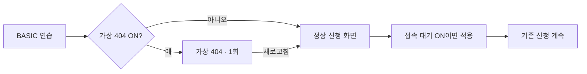
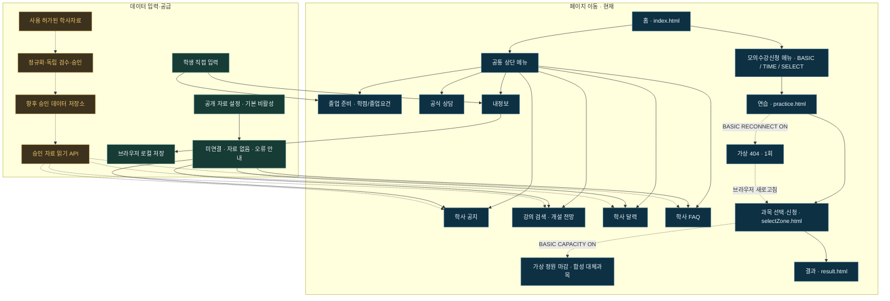

  

  <h1>한모 · Hanmo Develop</h1>

  
<strong>수강신청은 미리 연습하고, 다음 학기는 더 쉽게 준비하고.</strong> 한국외국어대학교 학생들의 모의수강신청과 학업 준비를 잇는 비공식 PC 웹 프로젝트

  

    
    
    
    
  

  

    <a href="#experience">한눈에 보기</a> ·
    <a href="#changes">추가된 기능</a> ·
    <a href="#flow">연습 흐름도</a> ·
    <a href="#next">학기 준비</a> ·
    <a href="#site-flow">전체 구조</a>
  

한모의 방향을 표현한 일러스트입니다. 실제 브라우저 화면 캡처가 아닙니다.

수강신청을 앞두고 학생들이 하는 고민은 신청 버튼을 누르는 순간에만 머물지 않습니다. **어떤 강의를 담을지, 내게 해당하는 공지는 무엇인지, 다음 학기를 어떻게 채울지.** 익숙한 연습 화면에서 시작해 이런 질문들을 이어서 살펴볼 수 있다면 어떨까요?

**한모(Hanmo)**는 [dlacked/Hanmo](https://github.com/dlacked/Hanmo)의 **BASIC · TIME · SELECT 모의수강신청**을 토대로, 학사 공지·강의 검색·개설 전망·학점 정리까지 이어지는 학생용 공간을 만들어 갑니다.

**현재 사용할 수 있는 기능은 BASIC/TIME/SELECT 모의연습, BASIC의 선택형 가상 404·가상 정원 마감, 내정보·학점 직접 입력과 로컬 저장, 졸업 준비 탭, 학사 달력·FAQ·공식 상담 경로 탐색**입니다. 강의 검색에는 개설 전망이 통합되어 있습니다. **학교의 강의·공지·학칙 원문은 아직 승인·연결되지 않았으므로 공식 학사 판정이나 마감 안내를 제공하지 않습니다.**

## 수강신청은 연습하고, 다음 학기는 미리 준비하고.

왼쪽은 실제로 연습할 수 있는 모의수강신청, 오른쪽은 학업 준비를 위한 확장 화면입니다. 학사 공지·강의 데이터는 아직 연결 준비 중입니다.

### 학생이 한모에서 이어갈 경험

| 궁금한 순간 | 한모에서 이어지는 경험 |
| :--- | :--- |
| **“수강신청 화면이 아직 낯설다면?”** | BASIC·TIME·SELECT로 시작 시각과 신청 순서를 반복 연습 |
| **“내 전공 공지와 수강 일정은 어디서 확인하지?”** | 학사 공지를 찾아보고 공식 원문으로 이어지는 학생용 탐색 화면 *(자료 연동 전)* |
| **“다음 학기에 듣고 싶은 강의가 열릴까?”** | 강의 검색·개설 전망에서 학기와 과목을 살펴보는 준비 화면 *(자료 연동 전)* |
| **“이번 학기까지 학점을 얼마나 모았지?”** | 졸업 준비 [학점]/[졸업요건]에서 직접 입력한 학점과 남은 학점 확인 |
| **“공식 학사 일정과 상담은 어디에서?”** | 학사 달력·학사 FAQ·공식 상담 탐색 화면에서 학교 확인 경로 찾기 *(공식 자료 인수 전)* |

수강신청 연습과 학사 안내가 따로 멈추지 않고 **학생 스스로 다음 행동을 찾는 하나의 동선**으로 이어지는 것, 그것이 한모가 만들고 싶은 경험입니다.

## 원작에서 이어받은 것, 새로 더한 것

| 기존 한모의 경험 | 확장된 경험 |
| :--- | :--- |
| **BASIC · TIME · SELECT** — 전체 신청, 시작 타이밍, 과목 신청 속도 연습 | **BASIC 선택형 돌발상황** — 가상 404는 새로고침으로 복구하고, 가상 정원 마감(`CAPACITY`)은 임의 한 과목 마감 후 합성 대체과목을 조회 |
| **SETTING** — 연습할 과목 수와 기본 신청 대기 | **대기 조건 분리** — 강의 신청 대기 기본 **예**, 신청 페이지 접속 대기 기본 **아니오** |
| **익숙한 신청 화면과 결과 흐름** | **RECONNECT·CAPACITY 각각 기본 OFF** — 같은 탭 선택을 보존하며 원본 신청/대기/결과 흐름과 실제 학교 자료를 분리 |
| **모의수강신청에 집중한 PC 웹** | **내정보·학사공지·강의 검색(전망 통합)·졸업 준비·학사 달력·학사 FAQ·공식 상담** — 직접 입력과 공식 검수 상태 구분 |

**보호하는 핵심:** 원작의 <code>practice.html</code> 및 BASIC/TIME/SELECT의 신청·대기번호·키보드·결과 흐름은 회귀 기준입니다. <code>selectZone.html</code>·<code>selectZone.js</code>·<code>practice.css</code>는 승인된 BASIC 합성 정원 마감 범위에서 변경됐으며, 원본 동작을 계속 검증합니다. BASIC/TIME/SELECT의 기존 대기번호·키보드·시간 측정·결과 동작은 유지해야 할 기준입니다. 가상 404는 별도 페이지 전환 로직에서 처리하며, **실제 학교 수강신청이나 네트워크 장애와 연결되지 않습니다.** 실제 Windows Chrome/Edge 전체 모드·키보드 QA는 별도 검증 항목입니다.

### BASIC 돌발상황, 한눈에 보기

  

RECONNECT와 CAPACITY는 각각 **기본 OFF**입니다. 이 도식은 가상 404 경로만 나타냅니다. CAPACITY는 BASIC의 합성 한 과목과 연습용 후보만 다루며 실제 학교 서버와 무관합니다.

분기 조건 상세 보기 · Mermaid flowchart

브라우저 뒤로가기는 404 복구 방법으로 지원하지 않습니다. 이 화면은 실제 학교 서버 오류가 아닌 연습용 가상 상황입니다.

## 익숙한 연습에서, 학업 준비까지

신청 당일의 타이밍 연습만큼이나 중요한 것은 **학생이 자기 상황에 맞는 학사 공지와 강의 정보를 쉽게 찾고 다음 학기를 준비하는 일**입니다. 한모는 연습을 마친 뒤에도 공지·강의·학점 계획을 같은 공간에서 살펴보는 경험을 지향합니다.

학사 정보의 실자료 연동은 아직 진행 전이므로, 화면이 갖춰져 있다는 사실을 실제 서비스 운영으로 표현하지 않습니다.

### 지금 이용할 수 있거나 미리 살펴볼 수 있는 화면

| 화면 | 해볼 수 있는 일 | 현재 상태 |
| :--- | :--- | :--- |
| **모의수강신청** · [열기](html/vsugang.html) | BASIC/TIME/SELECT, 기본 OFF인 가상 404·정원 마감, 독립 대기 설정 | **합성 모의연습 가능** · 실제 신청 아님 |
| **내정보** · [열기](html/planner.html) | 캠퍼스·전공·입학년도 직접 입력과 로컬 저장 | **직접 입력 가능** · 학교 학적 미연동 |
| **학사 공지** · [열기](html/academic-timeline.html) | 공식 공지 원문 확인 경로 | 승인 공지 스냅샷 미연결 |
| **강의 검색·개설 전망** · [열기](html/catalog.html) | 하나의 검색 화면에서 자료 상태·전망 확인 | 승인 강좌·개설 원장 미연결 (`forecast.html`은 이 페이지로 이동) |
| **졸업 준비** · [열기](html/academic-progress.html) | [학점]/[졸업요건] 탭과 직접 입력 학점·남은 학점 | **로컬 계산 가능** · 공식 졸업자격 미판정 |
| **학사 달력** · [열기](html/academic-calendar.html) | 월간 달력과 학교 공식 일정 링크 | 검수된 확정일·예상 구간 미인수 |
| **학사 FAQ** · [열기](html/academic-faq.html) | 질문·주제 탐색과 공식 확인 경로 | 검수 근거형 답변 미연결 |
| **공식 상담** · [열기](html/academic-support.html) | 공개 상담 부서·주제별 안내 링크 | 최신성·학생 적용 별도 확인 필요 |

**안내:** 학사 데이터 설정은 현재 비활성 상태이며 학교 공식 서비스와 연동하지 않습니다. 학사 일정·신청 자격 등 중요한 판단은 [한국외국어대학교 공식 홈페이지](https://www.hufs.ac.kr/)와 원문 공지를 확인해 주세요. 자료 이용·검수·운영 기준은 [아키텍처](docs/architecture.md)에서 확인할 수 있습니다.

## 전체 구조 · 화면과 데이터의 연결

모의수강신청에서 시작해 **공지·강의 검색/전망·졸업 준비·달력·FAQ·상담으로 이어지는 한모의 구성**입니다. 실선은 현재 페이지·데이터 경로, 점선은 선택형 돌발상황 또는 **학교 자료 이용·검수 승인 후 연결할 흐름**을 뜻합니다.

학사공지·강의 검색(개설 전망 통합)·졸업 준비·학사 달력·FAQ·공식 상담은 탐색 화면이 준비되어 있지만, 학교의 승인 학사자료와 Supabase 실서비스는 아직 연결하지 않았습니다. 구현 범위와 검증 조건은 [아키텍처 문서](docs/architecture.md)에 정리되어 있습니다.

### 개발 및 자동 검증

Node.js 22 환경에서 `npm ci`로 잠금 파일의 의존성을 설치한 뒤 `npm run check`로 학업 계산·원본 회귀·정적 페이지 검사를 수행합니다. 브라우저 테스트는 `npx playwright install chromium` 후 `npm run test:e2e`로 실행합니다. Chromium 자동 검사는 Windows Chrome/Edge·NVDA 실기기 인수를 대신하지 않습니다([#72](https://github.com/ot4562-glitch/Hanmo_develop/issues/72)).

[설계 문서](docs/architecture.md) · [문서 안내](docs/README.md) · [개발 이슈](https://github.com/ot4562-glitch/Hanmo_develop/issues) · [라이선스](LICENSE)

---

  
<strong>수강신청을 연습하는 곳에서, 다음 학기를 준비하는 곳으로.</strong>

  Based on <a href="https://github.com/dlacked/Hanmo">dlacked/Hanmo</a> · 비공식 한국외국어대학교 학생 프로젝트 학교 공식 서비스가 아니며 실제 수강신청·학교 로그인·공식 졸업사정을 제공하지 않습니다.

