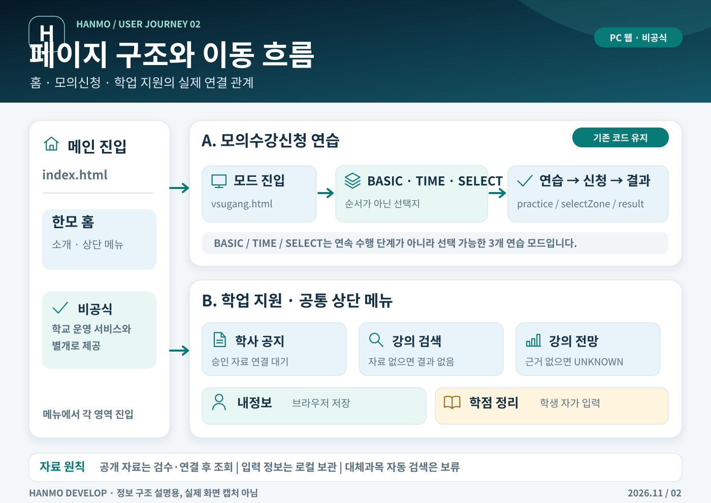
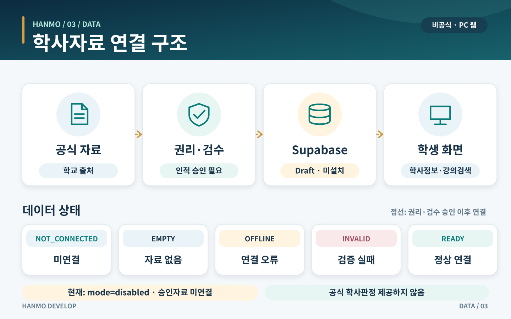

# 한모 개발 프로젝트 · 학사종합지원센터 참고자료

> **2026년 11월 22일 현행 코드 기준 · 비공식 학생 프로젝트 / 자료 검토 요청용.** 학교가 제작하거나 운영하는 공식 서비스가 아니며, 공개된 학교 자료의 이용·재배포에 대한 사전 승인을 받은 것으로 표시하지 않습니다.

과거 검토용 [프로젝트 소개 도식(2026-11-20 판본)](images/hanmo-01-project-overview.svg)은 현재 삭제된 '가상 실패' 옵션이 포함된 **역사적 참고자료**이므로 최신 기능 안내로 제시하지 않습니다. 현행 기능은 아래 설명과 [아키텍처 상태표](architecture.md)를 기준으로 확인해 주세요.

## 1. 프로젝트 취지와 실제 범위

**한모(Hanmo Develop)**는 [기존 한모 모의수강신청 프로젝트](https://github.com/dlacked/Hanmo)의 **BASIC·TIME·SELECT 연습 흐름을 보존**하면서 학사공지·강의검색·개설 전망 등 학생용 학업 정보 확인 화면을 확장하는 비공식 **PC 웹** 개발 프로젝트입니다. 학생들의 정보 탐색을 돕되 공식 수강신청, 성적 원장, 졸업사정, 학교 계정 로그인 기능을 대신하지 않습니다.

현재 BASIC/TIME/SELECT 모의연습에 더해 **BASIC 모드에서만 선택 가능한 가상 404·새로고침 복구 연습 한 가지**가 있습니다. 돌발상황 선택은 새 탭 기본 OFF이며 같은 탭에서 확인한 설정이 유지됩니다. 필수 SETTING의 강의 신청 대기(기본 예)와 신청 페이지 접속 대기(기본 아니오)를 별도로 선택할 수 있고, 404와 접속 대기를 함께 켜면 404 새로고침 복구 후 대기창을 보여줍니다. 가상 마지막 과목 신청 실패 옵션은 삭제했습니다. 검증된 실제 강좌 데이터에 의존하는 **대체과목 검색·자동 추천·시간 충돌 판정은 2차 범위에서 제외**했습니다. 학생 본인이 입력하는 내정보·학점 정리 기능은 참고용이며 공식 이수 판정이 아닙니다.

## 2. 학교 학사자료를 연결하기 위한 안전 기준

현재 **과거 참고용 공지 JSON, 가상 강좌·합성 개설 이력은 학생용 공개 화면에서 제거**했습니다. 학업 정보 공개 설정은 **기본 비활성**(`data/academic-source-config.json`의 `mode: disabled`)이며, 실제 Supabase 프로젝트·학교 학사자료는 연결되지 않았습니다.

학사자료 연결 절차는 **자료 이용 권리 확인 → 출처·개정판본·대상 조건의 독립 검수와 승인 → 공개 유효판본 생성 → 읽기 전용 학생 화면**으로 설계했습니다. Supabase Free($0)는 **승인 전의 기술 설계 선택**입니다. [Draft PR #93](https://github.com/ot4562-glitch/Hanmo_develop/pull/93)은 격리 PostgreSQL 16에서 SQL 설치·보안·철회 검증(Node 14건, SQL 점검 20건)을 통과했지만, **현재 `main`에 미병합이고 실제 Supabase 프로젝트·학교 자료 수집·운영 연동도 하지 않았습니다**. 원문 링크와 적용 대상·시각은 신뢰 가능한 검수본에 근거해야 합니다.

학생용 화면은 `NOT_CONNECTED`(미연결), `EMPTY`(공개 승인 자료 없음), `OFFLINE`(통신·API 실패), `INVALID`(판본·유효성 문제), `READY`(유효한 공개판본) 상태를 구분합니다. 실패 시 예전 테스트 데이터를 대체로 노출하지 않고 **재시도 및 공식 원문 확인 경로**를 안내합니다. 학생 성적·내정보를 원격 DB에 자동 업로드하지 않습니다.

## 3. 현재 단계와 향후 계획

현재 PC 웹 화면은 **원본 스타일을 보존하도록 동결**했습니다. HUFS One AI에서 이식한 학업 코어·테스트를 포함한 **TypeScript 소스의 JavaScript/JSDoc 전환은 완료**됐습니다([PR #100](https://github.com/ot4562-glitch/Hanmo_develop/pull/100)·[#102](https://github.com/ot4562-glitch/Hanmo_develop/pull/102)). 다만 학교 원문 검수, 사용자 PC 브라우저 시험, 실서비스·운영 인수는 **완료되지 않았습니다**. 3차 Supabase 실연동과 4차 제품 최종 품질 인수는 각각 별도로 검증합니다.

과거 [4단계 로드맵 도식(2026-11-20 판본)](images/hanmo-04-roadmap.svg)은 현재 완료된 JavaScript 소스 전환을 **미완료로 표시**하므로 시각 참고용으로만 보존합니다. 최신 단계별 상태와 검증 조건은 [아키텍처 현황표](architecture.md#현행-구현-상태--2026-11-22-main-기준)를 따릅니다.

## 4. 학사종합지원센터에 검토를 요청드리고 싶은 사항

- **자료 범위 및 사용권:** 학사공지, 학사일정, 공개 강좌·분반·시간표 등 학생에게 재안내할 수 있는 자료의 **이용/재배포 가능 범위**, 금지되는 수집·저장·가공 방법, 필요한 사전 절차
- **원문 안내 방식:** 공식 페이지의 직접 링크 제공, 게시일·정정·취소·철회 반영, 링크 만료·이동 시 안내 등 **원문 확인 정책**
- **표현 및 책임 경계:** 비공식 학생 서비스의 표시 방식, 실제 신청·이수·졸업 판정을 오인시키지 않는 문구, 오류 신고·정정 협력 경로

어떠한 자료 요청도 **승인된 공식 서비스 지위** 또는 학교의 보증을 요청한다는 뜻이 아닙니다. 센터 검토에 따라 기능을 보류·축소할 수 있습니다.

**코드와 근거:** [GitHub 저장소](https://github.com/ot4562-glitch/Hanmo_develop) · [현재 아키텍처](architecture.md) · [학사자료 연결 인계](student-data-source-handoff.md). 그림 4종의 SVG 원본은 저장소에 보존돼 있지만 **1번·4번은 과거 판본**이므로 배포·대외 제출에 앞서 최신 내용으로 교체해야 합니다. 이번 정리는 텍스트 안내의 정확성을 우선하며 그림 자체는 수정하지 않았습니다.
